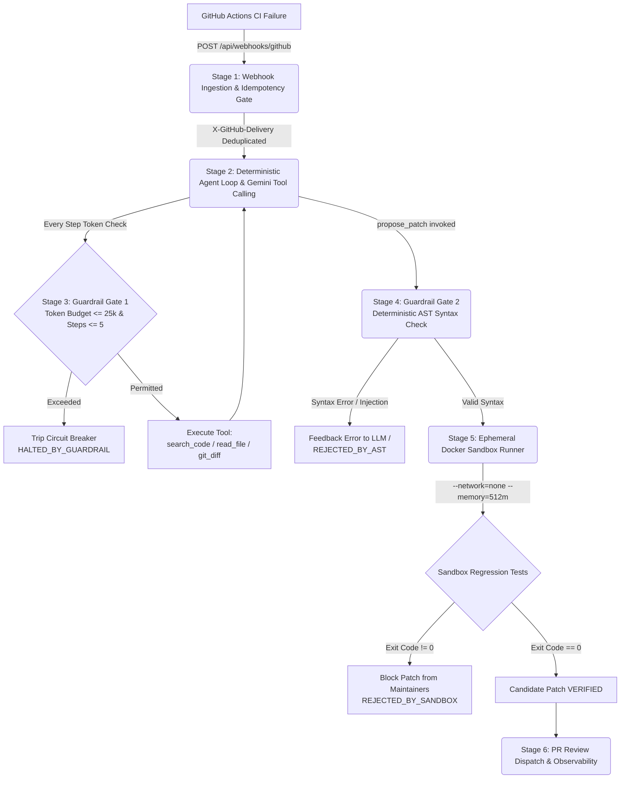

# PatchPilot — System Architecture Deep Dive

## Executive Summary
**PatchPilot** is an event-driven autonomous CI failure triage and debugging agent built with **TypeScript, Node.js, Google Gemini API, Docker, PostgreSQL, and Next.js**. It ingests failing GitHub Actions CI runs via webhooks, conducts multi-step root-cause analysis through strictly bounded tool calling, validates candidate patches using deterministic AST parsing in < 5 ms, and verifies regression tests inside isolated, resource-capped Docker sandboxes before dispatching Pull Request review comments.

---

## 1. End-to-End 6-Stage Execution Pipeline



---

### Stage 1: Webhook Ingestion & Idempotency Gate
- **Endpoint:** `POST /api/webhooks/github`
- **Security:** HMAC-SHA256 signature verification (`X-Hub-Signature-256`) using `crypto.timingSafeEqual`.
- **Idempotency Gate:** Uses the unique `X-GitHub-Delivery` UUID header.
  - Before initiating any LLM reasoning or database allocation, the delivery ID is looked up in the `WebhookDelivery` table.
  - If already processed, the endpoint returns an immediate `200 OK` (`Duplicate delivery already processed`) with zero duplicate LLM calls or sandbox containers.
  - New deliveries are recorded with their SHA-256 payload hash and processed.
- **Log Parsing:** Strips ANSI terminal escape codes, extracts failing assertion messages, target test file paths, and commits to the `IncidentRun` table (`status: QUEUED`).

---

### Stage 2: Deterministic Agent Loop & Gemini Tool Calling
- **Orchestration:** Managed by `AgentOrchestrator` (`packages/agent-core/src/orchestrator.ts`).
- **Loop Bounding:** Hard step cap of **`MAX_STEPS = 5`** to prevent infinite ReAct feedback loops.
- **Tools Declared via Structured JSON Schema:**
  1. `search_code({ query: string, filePattern?: string })`: Scans workspace files; path-traversal protected against escaping repo root.
  2. `read_file({ filePath: string, startLine: number, endLine: number })`: Bounded to maximum 200 lines per call to protect the LLM context window.
  3. `git_diff({ commitSha: string, filePath?: string })`: Inspects triggering commit diffs to isolate recent regressions.
  4. `propose_patch({ targetFile: string, unifiedDiff: string, rootCauseSummary: string, targetTestCommand: string })`: Terminal tool invoked when root cause is isolated.
- **Telemetry Tracking:** Wall-clock latency (`llmLatencyMs` and `toolLatencyMs`), prompt tokens, and completion tokens are recorded for every single step and stored in `AgentStepTrace` and `ToolCallLog`.

---

### Stage 3: Guardrail Gate 1 (Token-Budget Circuit Breaker & Loop Cap)
- Before invoking Gemini at each iteration:
  - Cumulative tokens (`totalPromptTokens + totalOutputTokens`) are verified against `MAX_TOKENS_PER_RUN = 25,000`.
  - Current step index is verified against `MAX_STEPS = 5`.
- If either threshold is breached, execution terminates immediately with `status: HALTED_BY_GUARDRAIL` and `haltReason: TOKEN_BUDGET_EXCEEDED` or `STEP_CAP_REACHED`.
- This ensures zero runaway API costs under adversarial or complex failing runs.

---

### Stage 4: Guardrail Gate 2 (Deterministic AST Syntax Check)
- **Engine:** `AstValidator` (`packages/sandbox-runner/src/ast-validator.ts`).
- When `propose_patch` is called, the unified diff is applied in-memory to the target file.
- The patched file is parsed using the **TypeScript Compiler API** (`ts.createSourceFile`).
- Parse diagnostics are extracted in **< 5 ms**:
  - If syntax errors exist (e.g. unclosed brackets, missing identifiers), the patch is rejected immediately with exact line and column coordinates.
  - If dangerous injection calls exist (e.g. `subprocess.Popen`, `child_process.exec`, `eval`), the patch is blocked by security guardrails.
- **Efficiency:** Prevents spinning up unnecessary Docker containers for code that cannot even compile.

---

### Stage 5: Isolated Docker Sandbox Verification
- **Engine:** `SandboxRunner` (`packages/sandbox-runner/src/sandbox-runner.ts`).
- **Isolation Flags:**
  ```bash
  docker run --rm \
    --network=none \
    --memory=512m \
    --cpus=1.0 \
    --pids-limit=64 \
    --read-only \
    -v /repo:/workspace:rw \
    -w /workspace \
    node:20-alpine sh -c "npm test -- path/to/failing.test.ts"
  ```
- **Security Protections:**
  - `--network=none`: Zero outbound or inbound network access prevents data exfiltration and external C2 communication.
  - `--memory=512m`: Caps container memory to prevent Out-Of-Memory host starvation.
  - `--cpus=1.0`: Caps CPU consumption.
  - `--pids-limit=64`: Blocks fork bomb exploits.
  - `SANDBOX_TIMEOUT_MS = 30000`: Strict 30-second timeout forcibly terminates hung tests with exit code 124.
- **Pass/Fail Criteria:** Only marked `VERIFIED` if `exitCode === 0`. If `exitCode !== 0`, marked `REJECTED_BY_SANDBOX`, preventing hallucinated fixes from reaching humans.

---

### Stage 6: PR Review Dispatch & Observability
- When a patch is verified (and either auto-post is enabled or approved via the dashboard):
  - Formats a structured PR review comment containing:
    - Root-cause summary.
    - Verified unified diff / GitHub `suggestion` block.
    - Telemetry badge showing exit code 0, container duration, agent steps taken, and tokens used.
  - Posts to GitHub Pull Request via Octokit REST API and updates incident status to `PR_COMMENT_POSTED`.
